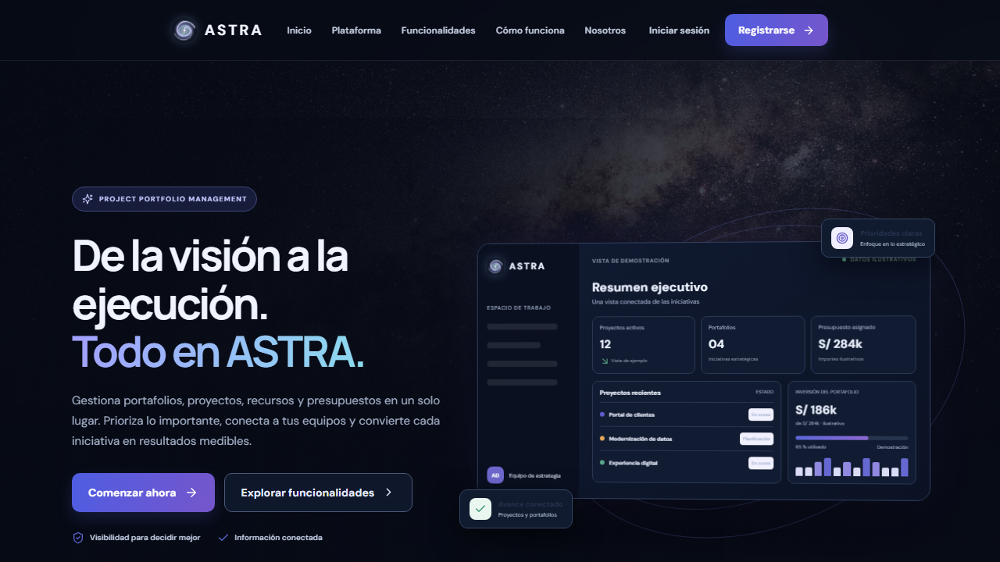

# ASTRA Milky Way Edition — informe de entrega

## Resumen

Esta entrega incorpora una imagen astronómica real en la experiencia pública, una marca vectorial galáctica y un flujo de registro funcional para desarrollo local. Se ampliaron las consultas de agente e informes para recorrer páginas de APIs de dominio hasta un límite explícito, y se agregaron pruebas del registro, paginación y fechas de recordatorio.

La captura corresponde a la suite E2E ejecutada con servicios locales. El fondo contiene la fotografía de la Vía Láctea; el crédito visible está en el pie de página.

## Identidad y recurso astronómico

- La landing y autenticación usan una fotografía local WebP con fallback JPEG, gradientes de contraste y tratamiento de movimiento reducido. No se carga el recurso desde un servidor remoto durante la ejecución.
- El logotipo está construido como SVG propio con núcleo, brazos espirales, halo y partículas; el favicon también se reemplazó por una variante estática. No se incrustó una fotografía rectangular en la marca.
- Fuente: ESO/F. Char, “Majestic Milky Way”, [página del recurso](https://www.eso.org/public/images/milkywaylasilla-cc/). ESO publica las condiciones [CC BY 4.0](https://www.eso.org/public/outreach/copyright/); se conservó atribución visible. La copia local se comprimió a WebP y se conserva el JPEG como fallback. ASTRA no está afiliada a ESO.
- Detalles y atribución: [docs/ASTRA_MILKY_WAY_ASSET.md](docs/ASTRA_MILKY_WAY_ASSET.md).

## Registro local

`/register` crea una organización local y su administrador inicial. `services/identity-service/local-auth.mjs` valida los cuatro campos permitidos, normaliza el correo, aplica una política de contraseña, deriva hashes con scrypt y escribe credencial, tenant, perfil y membership en una transacción DynamoDB. El tenant y rol ADMIN son generados por el backend; si falla la transacción no queda aprovisionamiento parcial. El adaptador local limita tamaño del cuerpo y solicitudes por IP.

El registro local emite el JWT local que ya entiende el middleware de desarrollo. No se expone esa ruta en los eventos HTTP API de AWS ni se reutiliza el JWT local allí. En AWS el registro de organización sigue pendiente: requerirá Cognito SignUp con verificación de correo y un trigger PostConfirmation idempotente que aprovisione tenant, perfil y membership. La arquitectura y la limitación se anotan en `services/identity-service/serverless.yml` y `docs/TEAM_SETUP.md`. No se ha configurado ni probado un User Pool real.

## Inteligencia y actividades: capacidades comprobadas

El agente local sigue siendo de **reglas deterministas limitadas**, no un LLM. Las consultas van a APIs de dominio usando el bearer autenticado; el tenant procede de los claims verificados y no de `tenantId` suministrado por el navegador. Una solicitud desconocida devuelve un error de intención no reconocida en lugar de simular comprensión.

- El E2E consultó proyectos atrasados/tareas mediante Project API y verificó el modo determinista y el alcance tenant-scoped.
- Los recordatorios aceptan fechas explícitas, hoy/mañana y nombre de día semanal, resuelven la zona horaria declarada y requieren confirmar una propuesta. La persistencia está en tabla DynamoDB; el scheduler lee el índice por vencimiento, crea buzón local idempotente y marca o reprograma el recordatorio. La entrega se etiqueta `SIMULATED_LOCAL` y **no se envía a WhatsApp**.
- La recurrencia persistida puede ser ONCE, DAILY o WEEKLY. El flujo de recordatorio semanal admite una frase de día de semana, pero una solicitud como “envíame un resumen todos los lunes” no genera por sí sola un reporte periódico: el scheduler ejecuta recordatorios, no programación de reportes. La persistencia tras reiniciar DynamoDB se basa en almacenamiento duradero local; la recuperación del proceso scheduler tras un reinicio no se ejercitó en esta E2E.
- Crear tarea es una acción privilegiada: propuesta, confirmación explícita, comprobación de rol y de proyecto en la API de dominio, operación idempotente y resultado persistido. No se ejecuta texto arbitrario como código o consulta.
- Los informes consultan APIs reales, siguen cursores hasta 10 páginas de 100 filas por servicio, registran alcance/servicios no disponibles y se guardan tenant-scoped. El máximo es 1 000 elementos por servicio; el truncamiento se señala. Se exporta CSV con escape de celdas potencialmente interpretadas como fórmulas. No hay filtros personalizados, PDF ni conversión de monedas.
- No se guardan acciones de reportes periódicos ni existe una programación de exportación CSV recurrente comprobada.

## Pruebas y resultados

Ejecución verificada en el entorno local existente (DynamoDB Local y LocalStack preexistentes; no se limpiaron sus volúmenes):

| Verificación | Resultado | Alcance |
|---|---:|---|
| `npm test` | 30/30 pasó antes de añadir los tests directos del parser | Pruebas Node; se volverá a ejecutar con los nuevos casos antes de publicación. |
| `npm run build --workspace frontend` | Pasó | TypeScript y build de Vite. |
| `py -3.11 -m pytest services/resource-service services/budget-service services/priority-service -q` | 18 pasó | Servicios Python. |
| `py -3.11 -m ruff check services/resource-service services/budget-service services/priority-service tests` | Pasó | Sin hallazgos Ruff. |
| `npm run test:e2e` | 2/2 pasó (31.7 s) | Registro nuevo, sesión, consulta, recordatorio persistente, scheduler/buzón, recurrencia diaria/semanal, tarea confirmada/idempotente, CSV descargable, notificación local, recurso S3 local, aislamiento entre tenants, vista móvil sin overflow y errores de página. |
| Captura E2E | Generada | `docs/ASTRA_MILKY_WAY_SCREENSHOT.png`. |
| AWS / Serverless deploy | No ejecutado | Sin despliegue ni credenciales AWS. Serverless v4 no está instalado aquí; no se validó empaquetado. |

La suite E2E realiza escrituras pequeñas en los volúmenes locales persistentes: organización de prueba, proyectos, tareas, recordatorios, reportes y eventos. No elimina filas ni volúmenes. Los servicios temporales de test deben detenerse al terminar; los contenedores DynamoDB Local y LocalStack preexistentes se conservan.

Una primera ejecución aislada falló por URL de Project API obsoleta en el entorno de prueba; la siguiente falló porque el adaptador de Identity de prueba no tenía `NOTIFICATION_MODE=local-simulator`. Se corrigió el cableado de variables de los procesos aislados y el E2E posterior pasó. Esos fallos fueron de preparación del entorno, no se ocultaron.

## Datos y AWS Academy

- No se ejecutó `seed:demo`, `seed:full`, una carga piloto ni generación masiva.
- No se desplegaron recursos AWS ni se ejecutaron comandos de despliegue/eliminación.
- El seed académico y sus protecciones quedan como estaban; cualquier carga real requiere autorización AWS Academy posterior.
- Cognito, aprovisionamiento, dominios, IAM y restricciones reales de laboratorio siguen sin verificar. El comentario del stack Identity explica el flujo requerido sin inventar IDs o ARNs.

## Reproducibilidad

Instala el stack conforme a [docs/TEAM_SETUP.md](docs/TEAM_SETUP.md), inicia Docker Desktop y ejecuta `npm ci` y `npm run dev:local`. Abre `http://localhost:5173`. El registro de una organización nueva está disponible en `/register`; para probar la E2E, levanta el stack y ejecuta `npm run test:e2e`. El E2E añade datos a los volúmenes activos; no limpia datos. Las cuentas de demo anteriores siguen siendo útiles para los tenants A/B.

El stack debe iniciarse con la configuración local (`VITE_AUTH_MODE=local`). En otra laptop, copia valores únicamente desde `.env.example`/archivos de ejemplo si el setup los requiere; no copies `.env`, credenciales de AWS ni bases locales.

## Archivos relevantes modificados o añadidos

- Frontend y marca: `frontend/index.html`, `frontend/public/favicon.svg`, `frontend/src/main.tsx`, `frontend/src/style.css`, `frontend/public/milky-way.webp`, `frontend/public/milky-way-source.jpg`.
- Registro y consultas: `scripts/local-api.mjs`, `services/identity-service/local-auth.mjs`, `services/identity-service/orbital.mjs`, `services/identity-service/serverless.yml`, `services/project-service/handler.mjs`.
- Pruebas y evidencia: `tests/e2e/astra.spec.ts`, `tests/frontend-utf8.test.mjs`, `tests/local-auth.test.mjs`, `tests/report-pagination.test.mjs`, `tests/orbital-parser.test.mjs`, `docs/ASTRA_MILKY_WAY_SCREENSHOT.png`.
- Guías: `README.md`, `frontend/README.md`, `docs/TEAM_SETUP.md`, `docs/ASTRA_MILKY_WAY_ASSET.md`.

## Limitaciones restantes

1. El registro de AWS/Cognito aún no está configurado: no hay flujo de aprovisionamiento probado en un User Pool.
2. ASTRA Intelligence tiene reglas intencionales y finitas; no interpreta solicitudes generales ni programa reportes recurrentes.
3. La exportación es CSV; los informes tienen tope de 1 000 resultados por servicio y no agregan filtros ni normalizan monedas.
4. WhatsApp permanece deshabilitado para entregas reales; solo existe simulación local.
5. Serverless Framework v4, empaquetado AWS, IAM y AWS Academy no se validaron en esta máquina.
6. Las verificaciones de la sección anterior se repetirán después de los cambios documentales y nuevos tests directos antes de crear el commit.

## GitHub

Remoto autorizado: <https://github.com/Pepe17xd/ProyectoCloud-Portafolios.git>. La edición se publicó en la rama `main` mediante push normal (fast-forward, sin force). El commit de implementación es `3a665c4` (`feat(astra): add Milky Way identity and local onboarding`). Se revisaron 22 rutas staged explícitas; el escaneo de patrones no encontró claves AWS, tokens GitHub ni bloques de claves privadas. Se excluyeron `.env`, credenciales, datos de base, cachés, artefactos de build y archivos locales ignorados. La referencia remota se verificó tras publicar la actualización documental.
