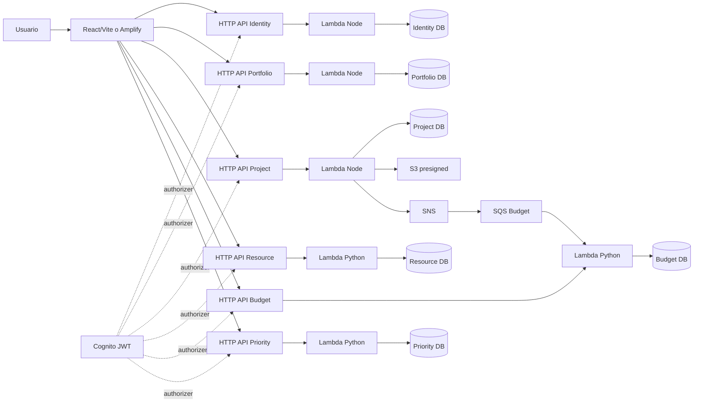
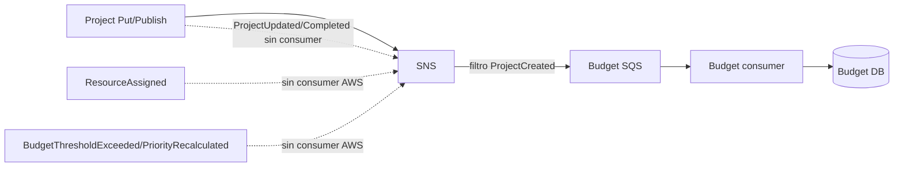

> Auditor?a inicial del repositorio, anterior a las iteraciones ASTRA Galaxy/Orbital. Es hist?rica; el estado actual est? en [ASTRA_ORBITAL_RELEASE_REPORT.md](ASTRA_ORBITAL_RELEASE_REPORT.md).

# Auditoría técnica integral de CloudPortfolio

Fecha: 21 de octubre de 2026 (America/Lima). Alcance: inspección estática. No se desplegó infraestructura, ejecutó seed ni alteró datos. “Implementado” refiere a código/configuración; “documentado” a afirmaciones; “probado” a ejecuciones con evidencia; “no verificado” a lo no comprobado aquí.

## 1. Resumen ejecutivo

CloudPortfolio contiene seis servicios, SPA React, configuración Serverless para AWS y entorno local declarado con DynamoDB Local/LocalStack. El código incluye objetivos, tareas, hitos, documentos S3, recursos/asignaciones, gastos y score/ranking. No se reejecutó stack ni UI/API integrada. Hay incoherencias entre docs y checkout. Multi-tenancy por PK está implementado como base, pero autorización y validación de relaciones son desiguales. Solo un consumidor SNS→SQS→Budget está conectado declarativamente. El requisito de 30 000 registros por servicio no está acreditado: el seed full lo configura, pero no se ejecutó; el reporte demo es inconsistente.

| Componente | Estado | Evidencia | Observaciones |
|---|---|---|---|
| Frontend | Parcial; no verificado | `frontend/src/main.tsx` | Login, CRUD, dashboard, Kanban, asignaciones, gastos, ranking en código. |
| Microservicios | 6 identificados | `services/*-service/` | 3 Node 20 ESM y 3 FastAPI Python 3.12 configurados. |
| API Gateway/Lambda | Declarado, no desplegado | YAML por servicio | HTTP API JWT Cognito; no empaquetado/verificado. |
| Multi-tenancy | Implementado sin verificación suficiente | shared y handlers | Queries tenant-scoped; faltan pruebas cross-tenant completas. |
| DynamoDB | Declarado; runtime no verificado | YAML/scripts | Una tabla por servicio, PK/SK, sin índices secundarios. |
| Eventos | Parcial | events YAML, Budget consumer | ProjectCreated→Budget; demás sin consumers AWS. |
| S3 | Parcial | Project handler/storage | URLs prefirmadas; ciclo completo no probado ni UI. |
| Amplify | Configuración presente | amplify.yml | Monorepo/lockfile raíz requieren validar appRoot. |
| Pruebas | Fuentes presentes; no corridas aquí | tests/docs | Reportes históricos contradictorios. |
| Seed 30k | Sin evidencia de cumplimiento | seed script/reporte | Full no ejecutado; demo report inconsistente. |
| Demo 2 tenants | No verificada | DEMO_SCRIPT.md | Secuencia documentada, no ensayada ahora. |

Preparación demo: baja/no verificada. No afirmar despliegue, 30k persistidos ni demo integrada sin evidencia actual.

## 2. Inventario

```text
cloudportfolio/
├── README.md, package.json, package-lock.json, seed-report-demo.json
├── frontend/                 React 19, TS, Vite, Amplify Auth, CSS
├── services/                 identity, portfolio, project, resource, budget, priority
├── shared/                   JWT/claims/RBAC/validación/keys/cursor
├── infrastructure/           Serverless Cognito/S3/SNS-SQS; Docker Compose
├── scripts/                  inicio local, APIs, worker, init, seeds
├── tests/                    pruebas Node
└── docs/                     arquitectura, datos, eventos, AWS, setup, demo, ADRs
```

Se excluyeron node_modules, dist y cachés. No se encontró `.git` (git status no disponible) ni AGENTS.md en inventario.

| Carpeta | Responsabilidad/stack | Estado |
|---|---|---|
| frontend | React 19/TS 5.8/Vite 6, Amplify Auth 6, lucide, CSS; app en main.tsx | Código, no browser test. |
| services | seis dominios; Node AWS SDK v3 y Python FastAPI/Pydantic/boto3/Mangum | Inspeccionado. |
| infrastructure | Serverless v4, Cognito, S3, SNS/SQS, Compose | Declarado, no desplegado. |
| shared | ESM auth/RBAC/helpers | 11 tests Node. |
| scripts | local API/worker/init/seed | No ejecutados; seed muta. |
| tests | Node + pytest | No ejecutados aquí. |
| docs | diseño/reportes/ADRs | Contradicciones importantes. |

Raíz: npm workspaces shared, frontend y services/*-service, Node >=20. Scripts test/test:all, dev:local, seed:demo/full/seed, local:down, install:all. Frontend dev/build (`tsc -b && vite build`)/preview. No se ve CI/E2E/lint raíz. install:all solo llama npm install.

## 3. Arquitectura actual



Diagrama AWS declarativo, no desplegado. Seis HTTP APIs, sin gateway agregado. Local: Compose DynamoDB Local/LocalStack; dev-local inicia tres adaptadores Node, tres Uvicorn, worker y Vite. Login local HS256, no Cognito. AWS: seis stacks Serverless con JWT Cognito/Lambda/tabla. Docs ARCHITECTURE, API_CONTRACTS, LOCAL_SETUP, AWS_DEPLOYMENT contienen partes obsoletas.

Cognito define claims custom tenantId/role; no hay triggers/provisionamiento visibles. Node consume authorizer claims o JWT local; Python valida HS256 local o JWKS RS256, con audience estándar desactivada y comparación manual condicional. Cada servicio posee su tabla; no se ven llamadas interservicio.

## 4. Auditoría por microservicio

| Servicio | Runtime/tabla | Funcionalidad | Evento/pruebas |
|---|---|---|---|
| identity | JS ESM Node20; identity table | users/tenants/memberships | SNS sin uso observado; sin tests handler |
| portfolio | JS ESM Node20; portfolio table | portafolios/objetivos | sin evento/test |
| project | JS ESM Node20; project table | proyectos/tasks/milestones/documentos | ProjectCreated/Updated/Completed; sin tests |
| resource | FastAPI/Python3.12; resource table | recursos/asignaciones/disponibilidad | ResourceAssigned; 2 tests modelo |
| budget | FastAPI/Python3.12; budget table | presupuestos/gastos/summary/consumer | ProjectCreated idempotente; 2 tests consumer |
| priority | FastAPI/Python3.12; priority table | assessment/ranking | PriorityRecalculated; 3 tests score |

### Identity

`services/identity-service/handler.mjs`, `serverless.yml`. CRUD GET/POST `/users`, GET/PATCH/DELETE `/users/{id}`; rutas equivalentes `/tenants` y `/memberships`. JWT. ADMIN requerido para users y DELETE; otros recursos siguen regla genérica. Perfil valida name/email/role/status. Membership valida userId/role pero no pertenencia. POST tenant usa tenantId del token como ID. PATCH membership filtra con whitelist de users (bug: no actualiza role/status de membership). PK tenant-scoped. Login AWS no está en handler; login local está en `scripts/local-api.mjs`. Errores 4xx/500 shared. Sin pruebas handler.

### Portfolio

`services/portfolio-service/handler.mjs`: GET/POST `/portfolios`, GET/PATCH/DELETE `/{id}`; CRUD `/portfolios/{id}/objectives[/{objectiveId}]`. Campos name/description/ownerId/status. JWT: VIEWER lee, MANAGER escribe, ADMIN elimina. Confirma padre por tenant. Objetivos usan `OBJECTIVE#portfolio#id`; lista devuelve `nextCursor:null`, puede truncar. Relaciones owner/proyecto no validadas. SNS declarado sin uso. Sin tests.

### Project

`services/project-service/handler.mjs`: CRUD `/projects[/{id}]`, tareas `/projects/{id}/tasks[/{taskId}]`, hitos `/projects/{id}/milestones[/{milestoneId}]`, POST/GET `/documents`, GET `/documents/{id}`. Task requiere title y enum TODO/IN_PROGRESS/BLOCKED/DONE; milestone name. Parent se verifica por tenant; portfolioId/ownerId no. JWT shared: viewer read-only, manager crea/actualiza, admin elimina. Publica eventos luego del Put (no atómico); payload eventId/type/version/tenant/entity/timestamp y payload variable. Documentos guardan metadata DOC#, comprueban proyecto, MIME allowlist y contentLength declarado 1–20MB; URLs PUT/GET expiran 600 s, prefijo tenant. Firma no impone tamaño real, sin limpieza/delete/UI. Sin tests handler.

### Resource

`services/resource-service/app.py`: ResourceIn name/type/capacity 0–1/status/skills; AssignmentIn resourceId/projectId/allocation 0–1/fechas. GET resources/list/detail, POST/PATCH/DELETE, POST/GET assignments, GET availability, health. JWT; VIEWER no escribe, MANAGER puede borrar (diverge Node). Verifica recurso, no proyecto; capacity usa una página sin transacción, riesgo de carrera. Availability ignora fechas y pagina; assignments filtra memoria. Publica ResourceAssigned sin consumer AWS. Dos tests solo de modelos.

### Budget

`services/budget-service/app.py`: BudgetIn projectId/allocated/spent/currency; ExpenseIn budgetId/projectId/amount/description. GET/POST budgets, GET/PATCH/DELETE, GET summary, GET/POST expenses y health. JWT tenant-scoped; viewer no escribe, manager puede delete. PATCH dict aplica allocated/currency sin modelo. Expense valida budget y coincidencia projectId, no proyecto existente. Expense y update spent son writes no atómicos; summary/expenses no paginan. Threshold publica BudgetThresholdExceeded sin consumer. Consumer ProjectCreated genera budget con clave estable/condición y partial batch failures. Dos tests fake consumer.

### Priority

`services/priority-service/app.py`: Assessment projectId e indicadores 0–100; criterios con pesos que sumen 1. Fórmula `.35*impact + .25*urgency + .25*alignment + .15*(100-risk)`. GET/POST priorities, POST recalculate, GET/PATCH/DELETE item, GET rankings, health. Viewer read-only, manager puede delete. No confirma proyecto tenant; ranking consulta una página. DELETE puede dar éxito sin item. Publica PriorityRecalculated sin consumer. Tres tests score, no API/tenant.

## 5. Frontend

Una app condicional en `frontend/src/main.tsx`, sin router ni separación de componentes; CSS en style.css. Auth Cognito/local, token local en localStorage. `request()` usa `VITE_API_*`. Login local `/auth/login` solo está en adaptador local; AWS Cognito. UI: dashboard, seis CRUD, Kanban, asignaciones, gastos, ranking; no objetivos, hitos ni documentos.

| Pantalla | Función/API | Estado/evidencia | Problema |
|---|---|---|---|
| Login | Cognito/local | Código, no browser test | sin reset/MFA; localStorage |
| Dashboard | seis list APIs/KPIs | Parcial | primeras 50, monedas mezcladas; error único falla todo |
| Portafolios | CRUD Portfolio | Parcial | objetivos no conectados |
| Proyectos | CRUD Project | Parcial | referencias como texto |
| Recursos | CRUD Resource | Parcial | UX skills/disponibilidad ausente |
| Presupuestos | CRUD Budget | Parcial | projectId requerido pero formulario genérico |
| Prioridades | CRUD/ranking | Parcial | vista especial calcula score |
| Kanban | task POST/PATCH | Código presente | sin editar/borrar/drag-drop |
| Asignaciones | Resource assignments | Código presente | integridad proyecto pendiente |
| Gastos | Budget expenses | Código presente | sin paging/summary visible |
| Ranking | recalculate/rankings | Código presente | criterios fijos |
| Objetivos/hitos/docs | backend | Ausente en UI | sin integración |

Busy/errors/notices, búsqueda local y paginación append. Search solo filas cargadas. Accesibilidad/responsividad no medidas; labels/aria limitados. Strings con mojibake. Amplify `npm ci` requiere validar lockfile raíz/appRoot monorepo; variables no verificadas. No se ensayó compatibilidad de URLs/rutas entre Uvicorn/API Gateway y UI.

## 6. Multi-tenancy

Node `claims()`/Python `actor()` obtienen tenant/sub/role del JWT; Get/Query usan `pk=TENANT#claim`, body no autoridad. Reduce IDOR directo. Cursores validan PK sin firma. Portfolio/Project validan parent; documentos validan proyecto.

Faltan pruebas cross-tenant de handlers. Resource valida resource, no project; Priority no verifica project; Identity membership no verifica usuario/tenant; Budget no confirma proyecto externo. RBAC desigual: Python permite DELETE a MANAGER, Node exige ADMIN; Identity tenant/membership no limita a ADMIN. Claims Cognito mutables sin proceso confiable visible. Aislamiento por clave implementado; extremo a extremo no validado y con riesgos de integridad/IDOR de dominio.

## 7. DynamoDB y datos

| Servicio | Tabla | PK/SK | Índices | Entidades |
|---|---|---|---|---|
| Identity | cloudportfolio-identity-stage | pk/sk string | ninguno | UserProfile ITEM, Tenant TENANTMETA, Membership MEMBERSHIP |
| Portfolio | cloudportfolio-portfolio-stage | pk/sk | ninguno | Portfolio ITEM, Objective OBJECTIVE#portfolio#id |
| Project | cloudportfolio-project-stage | pk/sk | ninguno | Project ITEM, Task, Milestone, Document DOC |
| Resource | cloudportfolio-resource-stage | pk/sk | ninguno | Resource/Assignment ITEM |
| Budget | cloudportfolio-budget-stage | pk/sk | ninguno | Budget ITEM, Expense EXPENSE |
| Priority | cloudportfolio-priority-stage | pk/sk | ninguno | Assessment ITEM |

JSON sanitizado:
```json
{"pk":"TENANT#tenant-demo","sk":"ITEM#project-uuid","id":"project-uuid","name":"Modernización de plataforma","portfolioId":"portfolio-uuid","ownerId":"user-uuid","status":"ACTIVE","createdBy":"cognito-sub","createdAt":"2026-10-21T12:00:00Z"}
```

Patrones GetItem y Query tenant/prefijo; no Scan observado. Sin GSI/LSI ni JSON schema completo. Queries de assignments, availability, expenses, summary/ranking no paginan; agregan en memoria. Identity/Portfolio/Project habilitan PITR; las otras no. Writes read-modify-write vulnerables a carreras.

FULL configura 10k IDs/tenant/servicio (30k servicio, 180k total), no ejecutado aquí. `seed-report-demo.json`: demo, 10 writes/tenant/servicio (180), conteos Identity 10001/9850/20, resto 20/20/20; snapshot inconsistente, no estado actual.

| Servicio | Tablas | Requeridos | Verificados ahora | A/B/C históricos del reporte | Estado |
|---|---:|---:|---|---|---|
| Identity | 1 | 30k | No | 10001/9850/20 | No acreditado |
| Portfolio | 1 | 30k | No | 20/20/20 | Bajo |
| Project | 1 | 30k | No | 20/20/20 | Bajo |
| Resource | 1 | 30k | No | 20/20/20 | Bajo |
| Budget | 1 | 30k | No | 20/20/20 | Bajo |
| Priority | 1 | 30k | No | 20/20/20 | Bajo |

## 8. Event-Driven Architecture



| Evento | Productor/payload | Consumidor | Reintentos/DLQ/idempotencia | Estado |
|---|---|---|---|---|
| ProjectCreated | Project; eventId/type/tenant/entity/time, payload/version variable | SNS→BudgetQueue→Budget | max receive 4/DLQ; partial failures; clave estable | Código/config, no reproducido |
| ProjectUpdated/Completed | Project PATCH, proyecto/estado | ninguno AWS | sin outbox | Publicadores presentes |
| ResourceAssigned | Resource IDs proyecto/recurso | ninguno | sin dedupe/outbox | Publicador presente |
| BudgetThresholdExceeded | Budget spent/allocated | ninguno | sin outbox | Publicador presente |
| PriorityRecalculated | Priority score | ninguno | sin outbox | Publicador presente |
| UserCreated/MembershipChanged | filtros solo local | productor ausente | no AWS | No funcional |

Hay un flujo de negocio codificado, no solo recursos. EDA transversal incompleta: AWS conecta ProjectCreated; publish tras DB Put, sin outbox. Consumer idempotente por clave, no eventId universal. Sin pruebas retry/DLQ/duplicados ni alarmas.

## 9. Seguridad

| Severidad | Hallazgo/ruta | Impacto |
|---|---|---|
| Alta | credenciales demo y secreto fallback local en `scripts/local-api.mjs` | Solo demo local; no exponer/reutilizar. No se reproducen valores. |
| Alta | RBAC desigual; Python deja delete a manager; Identity rutas genéricas | privilegios inconsistentes |
| Alta | referencias project/user no verificadas en varios servicios | asociación huérfana/IDOR de dominio |
| Alta | presigned PUT no impone tamaño real, metadata previa | objeto no coincide o huérfano |
| Media | CORS wildcard/default | allowlist por entorno |
| Media | audience Python desactivada/condicional | riesgo si configuración falta; API Gateway agrega capa AWS |
| Media | writes de budget/asignación no atómicos | carreras/inconsistencia |
| Media | Query agregadas sin paginar | KPIs incompletos |
| Media | IAM/package no revisados | fallo o permisos extra |
| Baja | sin audit log/rate limit visibles; errores en logs | trazabilidad/higiene |

No se reprodujeron secretos. No se encontró `.env` raíz. No se ejecutó npm audit.

## 10. Infraestructura y despliegue

Serverless v4: seis HTTP APIs Cognito JWT, Lambda/tablas on-demand; tres Node20 y tres Python3.12. Budget trigger SQS/partial failures. Cognito, SNS/BudgetQueue/DLQ/filter y bucket privado con bloqueo/cifrado/CORS. Project IAM Put/Get. Sin package/deploy AWS. Amplify build presente pero monorepo/appRoot/env no comprobados. Compose local declara DynamoDB Local/LocalStack persistentes; init crea seis tablas, bucket/topic/seis colas/DLQ, mientras AWS declara solo BudgetQueue. dev-local no ejecutado. Sin CI/orquestador de outputs. AWS/Amplify no verificados.

`AWS_DEPLOYMENT.md` dice que S3 API no existe, contradicho por Project handler. `ARCHITECTURE.md` dice que no hay Compose/LocalStack, contradicho por checkout.

## 11. Pruebas

| Tipo | Inventario | Resultado aquí |
|---|---|---|
| Node | `tests/shared.test.mjs`, 11 casos | No ejecutado |
| Python Resource | 2 modelos | No ejecutado |
| Python Budget | 2 consumer | No ejecutado |
| Python Priority | 3 score | No ejecutado |
| API/tenant | sin suite encontrada | No cubierto |
| UI/E2E | sin Playwright/Cypress | Ausente |
| Cloud/package | no validado | No verificado |

No ejecuté pruebas/instalación; Docker daemon no dio versión útil. `TEST_REPORT.md` afirma 12 Node, 7 Python, build y stack local exitosos; README/LOCAL_SETUP dicen que Docker/npm impedían validar. Histórico contradictorio/no reproducido. Sin porcentajes. Faltan tests handlers, RBAC/tenant, relaciones, cursor, eventos/DLQ, S3, concurrencia, E2E y empaquetado.

## 12. Evaluación PPM

| Capacidad | Estado | Evidencia |
|---|---|---|
| Portafolios/proyectos | Parcial | CRUD, relaciones incompletas |
| Tareas/subtareas | Parcial | tareas/Kanban; sin subtareas |
| Estados/prioridades | Parcial | estados y score |
| Dependencias | Ausente | sin modelo/ruta |
| Cronograma | Parcial | fechas sin Gantt/calendario |
| Hitos | Parcial | backend sin UI |
| Recursos/capacidad | Parcial | simple |
| Asignaciones | Parcial | integridad/concurrencia pendientes |
| Budget/gastos | Parcial | APIs; no atómicos/form incompleto |
| Dashboard/KPI | Parcial | primeras páginas/moneda mezclada |
| Reportes | Ausente | sin exportación |
| Notificaciones/automatizaciones | Parcial básico | presupuesto inicial por evento, no reglas |
| Usuarios/roles | Parcial | Cognito config/provisioning incompleto |
| Archivos | Parcial | presigned sin UI/validación integral |
| Auditoría/colaboración | Ausente | sin log inmutable/comentarios/actividad |

## 13. Comparativa de producto

Basada en fuentes oficiales citadas por `docs/PRODUCT_RESEARCH.md` (fecha indicada allí 20-oct-2026); no re-verificadas aquí, features dependen de plan.

| Funcionalidad | monday.com | Smartsheet | Planview | CloudPortfolio | Recomendación |
|---|---|---|---|---|---|
| Portfolio overview | dashboards/overview | lista/dashboards | reporting | CRUD/dashboard básico | health por portfolio |
| Tableros | Kanban/Table/timeline | vistas estructuradas | planificación | Kanban simple | UX propia ligera |
| Timeline/dependencias | Gantt/timeline | dependencias/calendario | escenarios | fechas/hitos | timeline de hitos |
| Workload | widget carga | disponibilidad | capacidad | assignments básicos | workload temporal |
| Finanzas | budget/esfuerzo | widgets budget | actuals/forecast | budget/gasto | forecast/alerta |
| Priorización | overview | prioridad iniciativa | score estratégico | score ponderado | criterios versionados |
| KPI | widgets | dashboards KPI | reporting | cards | health/progreso/burn rate |
| Automatización | reglas board | alertas | workflow | consumer inicial | alerta budget consumida |
| Colaboración | boards | sharing | decisión/gobierno | roles | decisión auditable |

Adoptar patrones de dominio sin copiar interfaces ni activos distintivos.

## 14. Cumplimiento académico

| Requisito | Estado | Evidencia | Brecha/acción | Prioridad |
|---|---|---|---|---|
| SaaS PPM AWS | Parcial | stacks declarados | no despliegue | Alta |
| Multi-tenancy | Implementado sin verificación suficiente | PK/claims | tests completos | Crítica |
| Serverless/event-driven | Parcial | seis YAML/un consumer | package/retry/outbox | Alta |
| Frontend Amplify | Configurado sin verificación | amplify.yml | build/publish/env | Alta |
| >=5 microservicios protegidos | Declarado sin verificación | seis YAML JWT | package/deploy/auth smoke | Alta |
| DB por servicio | Declarado sin verificación | seis tablas | runtime AWS | Alta |
| DynamoDB | Configurado, runtime no verificado | YAML | comprobar cloud | Media |
| 30k/servicio/3 tenants | No cumple evidencia | full 10k×3; demo inferior | seed y conteo real | Crítica |
| S3/SNS/SQS | Parcial | stacks/código | test API/entrega | Alta |
| despliegue Serverless automatizado | Parcial | manifiestos | pipeline/outputs/package | Alta |
| JSON de cada DB | Parcial | DATABASE_DESIGN | esquemas por entidad | Media |
| diagrama | Parcial | Mermaid docs | reconciliar implementación | Media |
| demo dos tenants | Sin verificación suficiente | scripts/guion | ensayo con evidencia | Crítica |

## 15. Hallazgos/deuda

Esfuerzo S <1 día, M 1–3, L >3 (relativo).

| ID | Hallazgo | Severidad | Ruta | Impacto/recomendación | Esfuerzo |
|---|---|---|---|---|---|
| CP-01 | 30k no acreditados/reporte inconsistente | Bloqueador | seed/report | FULL aislado y conteo real | M |
| CP-02 | UI/API no ensayadas | Alta | frontend/scripts | smoke browser por servicio | M |
| CP-03 | RBAC divergente | Alta | shared/Python | matriz única + tests | M |
| CP-04 | relaciones tenant incompletas | Alta | 4 servicios | validar IDs por tenant | M |
| CP-05 | Amplify monorepo puede fallar | Alta potencial | amplify.yml | fijar appRoot/probar | S |
| CP-06 | docs contradictorias | Media | docs | fechar/consolidar | S |
| CP-07 | eventos sin outbox | Alta | Project/events | outbox/reconciliación | L |
| CP-08 | queries sin paging/índices | Alta | Python | paginar/modelar GSI | M |
| CP-09 | upload S3 sin límite real/cleanup | Media | Project | policy/check/lifecycle | M |
| CP-10 | gasto/capacidad no atómicos | Alta | Budget/Resource | transacción/idempotencia | M |
| CP-11 | tests handler/API/tenant/UI ausentes | Alta | tests | contract/E2E | L |
| CP-12 | AWS package no probado | Alta | Serverless | package por stack | M |
| CP-13 | PATCH membership whitelist errónea | Media | Identity | schema/roles admin | S |
| CP-14 | objetivos no paginan | Media | Portfolio | cursor | S |
| CP-15 | delete Python éxito aunque inexistente | Media | Python | 404 uniforme | S |
| CP-16 | dashboard moneda/página parcial | Media | frontend | agregador/moneda | M |
| CP-17 | mojibake | Baja | frontend | encoding check | S |
| CP-18 | no CI/E2E | Media | raíz | pipeline | M |

## 16. Roadmap

| Fase/tarea | Prioridad/dependencia | Esfuerzo | Aceptación/evidencia |
|---|---|---|---|
| 1. Seed full 10k/tenant/tabla aislado | P0; Docker | M | JSON Query por tabla/tenant |
| 1. Matriz tenant/RBAC/relaciones | P0; reglas | M | positivos/negativos por rol/ruta |
| 1. Reconciliar docs/diagrama | P1 | S | actual/histórico fechado |
| 2. UI/API smoke y formularios | P0; fase 1 | M | crear/recargar flujos PPM |
| 2. Atomicidad gasto/capacidad | P1 | M | concurrencia consistente |
| 3. Dashboard/moneda/health/paging | P1; APIs | M | KPIs multi-page correctos |
| 3. Hitos/docs UI/accesibilidad | P2 | M | browser/teclado/viewports |
| 4. Prioridad versionada/decisiones | P2 | M | score explicable |
| 4. Workload/timeline/dependencias | P2; fechas/índices | L | vista sintética |
| 4. Alerta budget consumer | P2; eventos | M | procesamiento idempotente/DLQ |
| 5. Serverless package/Amplify build | P0 pre-cloud | M | artefactos sin deploy |
| 5. Deploy/runbook/demo | P0; autorización | L | demo dos tenants y evidencia |

## 17. Plan de demostración

1. Login ADMIN A: código presente, stack no ensayado.
2. Crear portfolio/proyecto y recargar: código presente, persistencia no verificada.
3. Mostrar ProjectCreated y budget: consumer presente, entrega no reproducida.
4. Crear recurso/asignación/disponibilidad: UI/API presentes; verificar proyecto/capacidad.
5. Calcular score/ranking: presente, probar integración.
6. Registrar gasto/resumen: presente, validar atomicidad/moneda.
7. Cambiar a B y consultar ID de A: keys lo soportan, cobertura completa pendiente.
8. Comparar roles: resolver discrepancia Python/JS primero.
9. Upload/download: API presente, UI ausente/no probado.
10. Mostrar 30k: pendiente seed full/conteo real.

Guardar HTTP, rol/tenant, IDs no sensibles, consultas read-only/logs redactados. No mostrar tokens ni secretos.

## 18. Conclusiones

1. Construido: seis servicios, tablas declaradas, UI/auth y PPM CRUD, tareas, recursos, gastos, scoring y documentos.
2. Hay lógica codificada, pero no se reprodujo; reporte histórico parcial contradicho por otros docs.
3. Configuración existe para seis servicios, DynamoDB separada, JWT, S3/SNS/SQS, Amplify/Serverless; cloud y volumen no verificados.
4. Pendiente: 30k persistidos certificados, integración UI, pruebas tenant/RBAC, AWS package/deploy, Amplify, S3/DLQ.
5. Cinco riesgos: datos 30k; demo sin ensayo; RBAC desigual; relaciones tenant sin validar; writes/eventos no atómicos.
6. Primero conteo FULL fiable y pruebas tenant/RBAC; luego smoke UI.
7. Mayor valor PPM: portfolio health, prioridad explicable, workload, timeline, dashboard financiero correcto.
8. Exposición lista para ensayo, demo no certificada.
9. Evitar seed en datos compartidos, borrar volúmenes, cambiar keys/claims sin pruebas, usar reporte viejo como actual.
10. Siguiente paso: smoke local aislado, matriz dos tenants/roles, conteo persistido y luego `serverless package` sin deploy.

### Límites y discrepancias

`TEST_REPORT.md` afirma ejecuciones exitosas; README/LOCAL_SETUP indican problemas Docker/npm. `seed-report-demo.json` es histórico desigual. ARCHITECTURE/AWS_DEPLOYMENT afirman no existir Compose/S3 API, aunque sí están en checkout; API_CONTRACTS/PRODUCT_RESEARCH omiten features de frontend actuales. Son resultados no reproducidos/revisiones distintas. No se reprodujeron secretos.
> Auditoría inicial del repositorio, anterior a las iteraciones ASTRA Galaxy/Orbital. Es histórica; el estado actual está en [ASTRA_ORBITAL_RELEASE_REPORT.md](ASTRA_ORBITAL_RELEASE_REPORT.md).
