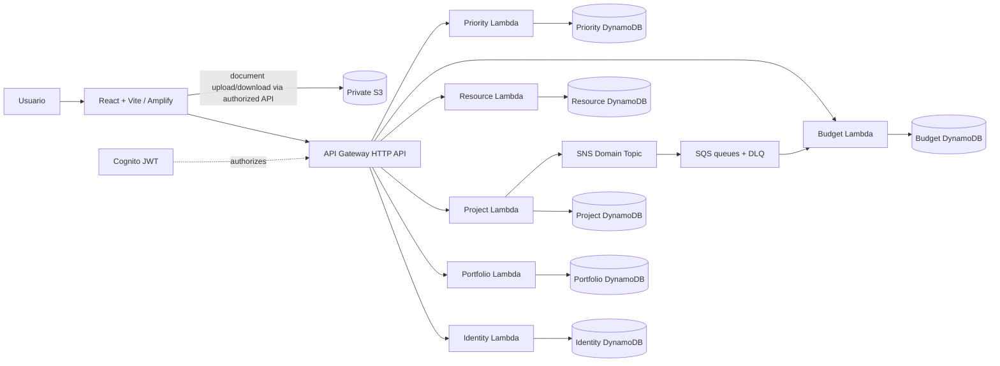

# Arquitectura CloudPortfolio

## Estado y alcance

Este documento describe el estado del repositorio auditado y un destino arquitectónico propuesto para el MVP. No se debe interpretar el diseño objetivo como funcionalidad ya desplegada. El checkout contiene seis servicios desplegables Serverless, pero cada uno usa actualmente un handler JavaScript con lógica CRUD casi idéntica y runtime Node.js 20; `resource`, `budget` y `priority` todavía no son servicios Python.

## Componentes observados

- Frontend Vite/React en `frontend/`, preparado para Amplify y configurado con Cognito Amplify Auth.
- Seis servicios: `identity-service`, `portfolio-service`, `project-service`, `resource-service`, `budget-service`, `priority-service`.
- Cada servicio define una tabla DynamoDB propia con clave `pk`/`sk` y consulta por partición `TENANT#<tenant>`.
- Cognito User Pool en `infrastructure/auth`; cada HTTP API declara JWT authorizer.
- SNS, SQS, DLQ y suscripción filtrada `ProjectCreated` en `infrastructure/events`.
- Bucket S3 privado con bloqueo de acceso público y cifrado en `infrastructure/storage`; no se encontró API de documentos.
- No se encontró configuración Docker Compose, DynamoDB Local, LocalStack ni proveedor OIDC local.

## Cambios de esta implementación local

- `infrastructure/docker-compose.yml` levanta DynamoDB Local y LocalStack con health checks y volúmenes nombrados.
- `scripts/init-local.mjs` crea seis tablas y provisiona bucket privado, SNS, seis colas y DLQ. `scripts/dev-local.mjs` inicia los seis adaptadores HTTP, un worker SQS y Vite.
- Identity local emite JWT HS256 firmados, con emisor y expiración; cada API valida firma, tenant, subject y rol. Este adaptador no es OIDC ni JWKS.
- Project Service firma URLs de upload/download S3 y persiste metadatos en su tabla. El S3 runtime aún no se validó.
- Los servicios Resource, Budget y Priority siguen implementados en Node.js; la arquitectura Python solicitada queda pendiente.

## Vista de contexto objetivo

La flecha hacia S3 representa el patrón objetivo, no un endpoint presente. En el repositorio actual API Gateway y Lambdas se definen en seis stacks de servicio separados; no existe un gateway agregado.

## Responsabilidades objetivo

| Servicio | Propiedad de datos y responsabilidad |
|---|---|
| Identity | Perfiles, tenants, membresías, roles y auditoría. Cognito es autoridad de autenticación; no almacenar contraseñas aquí. |
| Portfolio | Portafolios, objetivos y snapshots; referencias a proyectos por ID, sin leer tablas ajenas. |
| Project | Proyectos, tareas, hitos y actividad; emite eventos de cambios de dominio. |
| Resource | Recursos, habilidades, disponibilidad y asignaciones. |
| Budget | Presupuestos, revisiones, gastos y alertas; consume eventos de proyecto. |
| Priority | Criterios, evaluaciones, puntuaciones y snapshots de ranking. |

Los contratos entre servicios usan IDs y eventos versionados. Ningún servicio recibe permisos IAM para consultar la tabla privada de otro.

## Multi-tenancy y seguridad

En el diseño objetivo, el tenant proviene exclusivamente de claims JWT verificados (`tenantId`, `sub`, `role`), nunca de un parámetro del cliente. Cada acceso usa `PK = TENANT#<tenantId>`; el ID solicitado se resuelve bajo esa partición, de modo que un identificador de otro tenant no devuelve ni modifica su registro. RBAC se valida dentro de cada handler además del authorizer de API Gateway.

El código observado toma `custom:tenantId` y `custom:role` del contexto authorizer y consulta la partición del tenant. La política compartida permite GET a todos, bloquea writes a VIEWER y exige ADMIN para DELETE. Aún faltan pruebas de aislamiento/RBAC; el cursor se decodifica como JSON base64url sin firma y se debe endurecer. CORS predeterminado `*` tampoco es apropiado para producción.

## Eventos y consistencia

Flujo actualmente visible: Project Service guarda el proyecto y publica `ProjectCreated` a SNS; la suscripción SNS lo filtra a Budget SQS; `budget-service.consume` crea presupuesto inicial idempotentemente con escritura condicional y reporta fallos parciales. La publicación ocurre después de la escritura y no es atómica. El diseño recomendado es outbox transaccional y relay con deduplicación; hoy no está implementado. No se hallaron consumidores para los otros cinco tipos requeridos.

## Patrones de acceso actuales y objetivo

La tabla por servicio usa `pk` y `sk`; la operación de lista actual ejecuta `Query` en `pk = TENANT#...`, con límite máximo de 100 y `LastEvaluatedKey` como cursor. Get/Patch/Delete conforman clave compuesta dentro del mismo tenant. La tabla no declara GSI actualmente. La ampliación de filtros debe usar índices diseñados por patrón de consulta y no `Scan` en rutas normales.

## Decisiones arquitectónicas

1. Mantener despliegue independiente por microservicio y tabla propietaria.
2. Usar eventos solo para reacciones entre dominios que puedan ser eventual-consistent; responder solicitudes de lectura con la API dueña del dato.
3. Usar API Gateway JWT authorizer más autorización de dominio en Lambda.
4. Usar Cognito en AWS; sustituir localmente por OIDC compatible con JWKS antes de declarar login local completo. Actualmente solo Cognito está configurado.
5. Para archivos, API autorizada emite URLs prefirmadas de corta duración con prefijo de tenant, tamaño/tipo restringidos y bucket privado. La API de archivos es futura.
6. Para AWS, configurar stage/region y secretos por variables/SSM/Secrets Manager; no desplegar stacks automáticamente desde el seed.

## Riesgos y brechas

- El alcance TypeScript/Python y capas modulares exigido no coincide con handlers monolíticos JS actuales.
- Falta entorno local reproducible con Docker/LocalStack, setup de tablas/topics y seed local.
- Seed actual crea 10 000 registros por tenant por defecto (180 000 globales si corre para seis tablas), pero no es un seed demo aislado y no incluye reporte de conteos verificando persistencia.
- Outbox, idempotencia general, telemetría, S3 API y flujos PPM completos faltan.
- No se verificó despliegue real ni compatibilidad de todos los stacks con Serverless Framework.
