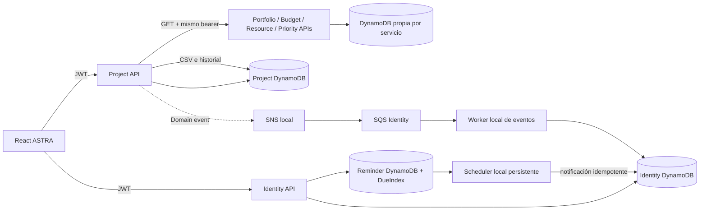

# Arquitectura ASTRA Orbital

ASTRA conserva seis microservicios. La interfaz React consulta las APIs con el JWT actual. Cada servicio conserva su DynamoDB; Identity posee usuarios/preferencias y una tabla adicional de recordatorios; Project posee proyectos/tareas e historial de reportes. El asistente local es determinista y no tiene acceso genérico a tablas ajenas.

En modo local, las APIs Node validan tokens de desarrollo; las APIs Python y Node consultan su propia tabla DynamoDB Local. LocalStack provee SNS/SQS y S3. Project Intelligence usa una allowlist HTTP de APIs autorizadas y tareas consultadas en su propia tabla. Se informa el límite de primera página.

El flujo de acciones no ejecuta texto libre: un parser limitado crea una propuesta en Identity, la UI muestra contenido/fecha/recurrencia, el usuario confirma con operationId y el handler revalida la clave tenant/user antes de persistir. El scheduler consulta DueIndex y escribe el buzón local. El buzón queda marcado `SIMULATED_LOCAL`; no se envía WhatsApp.

Los reportes Project consultan servicios de dominio con el mismo bearer, construyen CSV con límite 100 por servicio, indican servicios no disponibles/alcance parcial y persisten filas/metadatos en la tabla Project bajo clave tenant. Solo ADMIN/MANAGER pueden crear; lectura vuelve a derivarse del tenant del JWT.

En AWS se declararon la tabla `RemindersTable` con GSI `DueIndex`, API Identity, permisos de tabla/index y un Lambda programado EventBridge de un minuto, además de endpoints de reportes en Project. Esto es configuración de Serverless, no validación de empaquetado ni despliegue. Quedan por verificar restricciones de AWS Academy, billing/costos, calidad de agregados, concurrencia del scheduler, límites del GSI global de vencimientos y permisos entre APIs.
