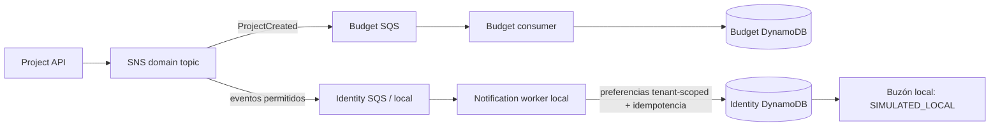

# Eventos ASTRA

## Flujos encontrados

| Evento | Productor | Consumer / efecto local | Estado |
|---|---|---|---|
| ProjectCreated | Project Service publica tras crear el proyecto | Budget worker crea presupuesto inicial; Notification worker añade una entrada local si la preferencia coincide | La ruta Project→SNS→Identity SQS→buzón fue ejecutada y asertada en Playwright local; budget consumer existente |
| ProjectUpdated / ProjectCompleted | Project Service | Notification worker local, con filtro por preferencia | Configurar y validar filtro de suscripción en la inicialización local |
| ResourceAssigned, BudgetThresholdExceeded, PriorityRecalculated | Servicios de dominio | Notification worker local recibe si SNS los publica y la suscripción los incluye | No todos los productores están configurados/confirmados |

En la suscripción local, el script `scripts/init-local.mjs` fija un filtro amplio para Identity. El worker conserva mensajes con error mediante visibility timeout; la cola ya declara DLQ local en el emulador. La prueba E2E verificó la entrega normal/idempotencia por evento; no se indujo una falla ni midió redelivery/DLQ. Las preferencias `daily` y `weekly` se almacenan, pero no se ejecutan; el worker local solo procesa eventos inmediatos.

## AWS

El stack `infrastructure/events` declara SNS, SQS y DLQ para ProjectCreated→Budget. No declara actualmente una cola/consumer AWS de notificaciones. No se debe interpretar la suscripción local de Identity como equivalente desplegado. El despliegue requiere definir consumidor Lambda/SQS, permisos mínimos, filtro, retención, redrive, idempotencia compartida y revisión de restricciones AWS Academy. Para horarios, evaluar EventBridge Scheduler con rol y límites del laboratorio; no crear recursos cloud en esta etapa.
