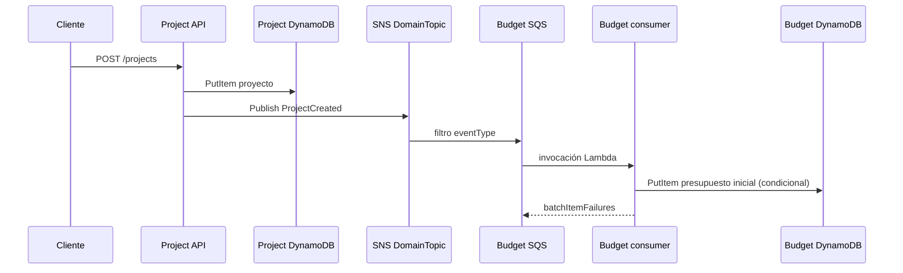

# Catálogo de eventos

## Sobre el estado actual

Project Service publica `ProjectCreated` al crear un proyecto, `ProjectUpdated` al editarlo y `ProjectCompleted` cuando cambia su estado a completado. Los eventos llevan `eventVersion`, `tenantId`, `entityId`, `occurredAt` y un payload mínimo. Budget consume `ProjectCreated` por SQS y crea un presupuesto inicial idempotente con escritura condicional. La infraestructura local prepara filtros SNS, colas y DLQ. No se ejecutaron pruebas de entrega real.

## Sobre común propuesto

```json
{
  "eventId": "uuid",
  "eventType": "ProjectCreated",
  "eventVersion": 1,
  "tenantId": "empresa-a",
  "entityId": "project-uuid",
  "occurredAt": "2026-10-20T12:00:00.000Z",
  "payload": {}
}
```

Los consumidores deben asumir entrega al menos una vez, validar esquema/tenant, deduplicar por `eventId`, y enviar mensajes irrecuperables a DLQ con alarma.

## Catálogo objetivo

| Evento | Productor | Consumidor objetivo | Estado |
|---|---|---|---|
| `ProjectCreated` | Project | Budget crea presupuesto inicial; Priority crea evaluación inicial opcional | Publicación/consumo Budget codificados; sobre no coincide con el esquema objetivo |
| `ProjectUpdated` | Project | Portfolio actualiza proyección/resumen | Productor implementado; sin consumidor conectado |
| `ProjectCompleted` | Project | Portfolio actualiza progreso; Budget cierra proyección | Productor implementado; sin consumidor conectado |
| `BudgetThresholdExceeded` | Budget | notificación/alerta; dashboard de riesgo | Pendiente |
| `ResourceAssigned` | Resource | Project actualiza actividad; Priority puede recalcular | Pendiente |
| `PriorityRecalculated` | Priority | Portfolio refresca ranking | Pendiente |

## Semántica y confiabilidad objetivo

- SNS topic por dominio; suscripciones SQS específicas por consumidor con filtros por `eventType`.
- Una DLQ por cola; política de redrive con límite de recepción configurable y alarmas de profundidad/edad.
- Consumidores idempotentes: escribir marcador de evento procesado en la misma base propiedad del consumidor, usando clave condicional y TTL de retención definida.
- Reintento exponencial gestionado por SQS; habilitar `ReportBatchItemFailures` para no repetir mensajes ya procesados de un lote.
- No incluir datos personales o secretos en eventos. Incluir referencias mínimas y `tenantId` para partición.
- Evitar ciclos: cada consumidor emite solo eventos de su propio cambio de estado y no reemite el mismo evento sin transición nueva.
- Outbox recomendado: persistir cambio y evento en una transacción DynamoDB del servicio productor; relay publica outbox y marca entrega. El handler actual escribe primero y publica después, por lo que un fallo SNS deja cambio persistido sin evento.

## Flujo actual ProjectCreated



El flujo omite outbox y prueba de persistencia; diseño de mecanismo durable queda pendiente.
